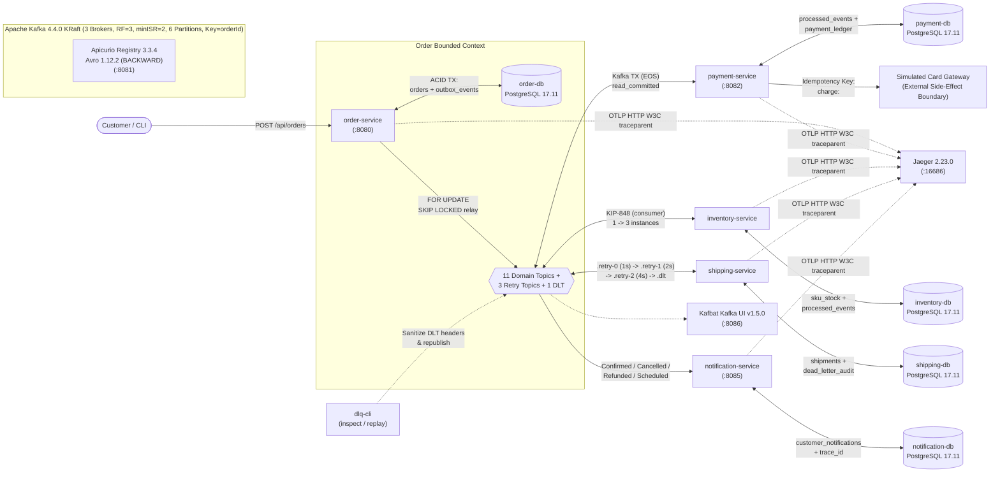

# Kafka Order Platform — Event-Driven Choreographed Saga on Apache Kafka 4.4.0 (KRaft)

[](https://github.com/Manzoor25/kafka-order-platform/actions/workflows/ci.yml)
[](LICENSE)

## The Problem

Synchronous microservice chains (`order -> HTTP -> payment -> HTTP -> inventory -> HTTP -> shipping`) fail badly under real-world partial failures:
- Dual-writing to PostgreSQL and a message broker splits state if a JVM dies mid-request.
- Enabling Kafka's `exactly_once_v2` transactions is widely misread as making external card charges "exactly-once"—until a crash between an HTTP payment capture and `commitTransaction()` triggers redelivery and double-charges the customer.
- A single malformed message or transient downstream error stalls an entire partition unless non-blocking retry topics and dead-letter replay tooling exist.
- Without schema compatibility gates and W3C trace propagation across outbox tables, independent deployments break consumers silently and turn async workflows into black boxes.

**`kafka-order-platform`** solves all four problems in a runnable 5-microservice reference platform where **peer services never call one another over HTTP** (enforced continuously by `NoInterServiceHttpArchitectureTest`).

---

## Architecture



---

## Pinned Technology Stack

| Component | Exact Pinned Version | Role |
|---|---|---|
| **Apache Kafka (KRaft)** | `apache/kafka:4.4.0` (`kafka-clients 4.2.0`) | 3-broker ZooKeeper-less KRaft quorum, KIP-848 `consumer` protocol, EOS transactions |
| **Java / JDK** | `Eclipse Temurin 21.0.13` | Records, pattern matching, virtual-thread-ready runtime |
| **Spring Boot / Spring Kafka** | `4.1.2` | Microservices, `KafkaTransactionManager`, non-blocking `RetryTopicConfiguration`, Flyway |
| **Schema Registry & Serialization** | `apicurio/apicurio-registry:3.3.4` + `Avro 1.12.2` | Strongly typed `.avsc` codegen, binary wire format, CI + Registry `BACKWARD` rules |
| **Databases** | `postgres:17.11-alpine` (×5 instances) | Dedicated database per service (`order`, `payment`, `inventory`, `shipping`, `notification`) |
| **Distributed Tracing** | `OpenTelemetry 1.62.0` + `jaegertracing/jaeger:2.23.0` | End-to-end W3C `traceparent` across HTTP, SQL outbox, Kafka headers, and DLT replay |
| **Kafka Cluster UI** | `ghcr.io/kafbat/kafka-ui:v1.5.0` | Browse brokers, KIP-848 consumer groups, Avro schemas, and `.dlt` payloads |
| **Integration Testing** | `Testcontainers 2.0.5` + `JUnit 5` + `Awaitility 4.3.0` | Per-service ITs + full 5-service choreographed saga E2E suite |

---

## One-Command Quickstart

Prerequisites: **Docker (with Compose v2)**, **GNU Make**, **Bash**, **Python 3**, and **JDK 21** (for local `make test`).

```bash
# 1. Build & boot 3 Kafka 4.4.0 KRaft brokers, 5 Postgres DBs, Apicurio, Jaeger, Kafka UI, and all 5 services
make up

# 2. Submit a live order, follow the choreographed saga to COMPLETED, and verify all 5 services in Jaeger
make demo

# 3. Run unit tests, Avro BACKWARD gate, per-service Testcontainers ITs, and 5-service E2E saga tests
make test

# 4. Tear down all containers and volumes cleanly
make down
```

### Local UIs (while `make up` is running)
- **Order REST Ingress:** `http://localhost:8080/api/orders`
- **Jaeger Distributed Tracing UI:** `http://localhost:16686`
- **Kafbat Kafka UI:** `http://localhost:8086`
- **Apicurio Schema Registry v3 API:** `http://localhost:8081/apis/registry/v3`

---

## Failure, Scaling & Schema Evolution Demos

Every scenario has an automated, self-verifying script in `scripts/` that exits non-zero if any invariant fails:

### 1. Kill a Broker Under Load (`make demo-kill-broker`)
Submits **30 live orders** (`RF=3`, `min.insync.replicas=2`, `acks=all`), sends `SIGKILL` to `kafka-2` mid-stream at order #10, verifies leader failover onto surviving ISR replicas `{1,3}`, confirms **0 lost acknowledged orders**, and heals the cluster back to `0` under-replicated partitions.

```text
>>> [FAULT INJECTED] Sending SIGKILL to broker kafka-2 after 10 acknowledged orders...
[2/5] Total HTTP 201 acknowledged orders: 30/30
[3/5] Inspecting partition leaders & shrunk ISR while kafka-2 (node 2) is DOWN:
      Topic: order.created.v1  Partition: 0  Leader: 1  Replicas: 1,2,3  Isr: 1,3
[4/5] Verifying EVERY acknowledged order (30/30) completes across all 5 services with 0 loss...
  -> Acknowledged orders : 30
  -> Completed orders    : 30
  -> Lost messages       : 0
[5/5] Under-replicated partitions after broker recovery: 0
[PASS] Failure Demo 1 succeeded: 30/30 acknowledged orders completed with 0 message loss!
```

### 2. Kill Payment Service Mid-Transaction (`make demo-kill-payment`)
Submits an order with fault token `tok_hold_mid_tx`: `payment-service` executes the external card charge (`Propagation.REQUIRES_NEW`), flushes uncommitted `PaymentAuthorized` into an open Kafka transaction (`order-service` still sees `status=CREATED` via `read_committed`), and receives **`SIGKILL` before committing**. Upon restart, Kafka fences the stale epoch and redelivers `OrderCreated`; deterministic `idempotencyKey = "charge:" + orderId` prevents a second charge.

```text
  -> Order status while Kafka TX is uncommitted (read_committed isolation): CREATED
[3/5] >>> [FAULT INJECTED] Sending SIGKILL to payment-service mid-transaction!
[5/5] Auditing external card gateway operations for ord-midtx-...:
  -> Idempotency Key         : charge:ord-midtx-...
  -> Actual Card Charges     : 1 (MUST be 1)
  -> Deduplicated Redelivery : 1 (>= 1 proves redelivery hit idempotency key)
[PASS] Failure Demo 2 succeeded: payment-service crashed mid-TX, recovered cleanly, and charged customer EXACTLY ONCE!
```

### 3. Poison Message, Non-Blocking Retry/DLT, and CLI Replay (`make demo-poison-dlt`)
Injects raw corrupt non-Avro bytes **and** a transient-poison order (`POISON-TRANSIENT`) onto `inventory.reserved.v1` ahead of two healthy orders. Healthy orders finish `COMPLETED` immediately (zero head-of-line partition blocking) while the poison records land in `inventory.reserved.v1.dlt`. Runs `dlq-cli inspect` and `dlq-cli replay` to strip DLT headers, preserve `traceparent`, and recover the order to `COMPLETED`.

```text
[3/5] Verifying partition keeps moving (healthy orders complete without head-of-line blocking)...
  -> Healthy order ord-healthy-a-... status=COMPLETED
  -> Healthy order ord-healthy-b-... status=COMPLETED
[4/5] --- dlq-cli inspect output ---
  partition | offset | key              | format            | exception
  ...       | ...    | ord-corrupt-...  | RAW_CORRUPT_BYTES | DeserializationException
  ...       | ...    | ord-poison-...   | AVRO              | TransientCarrierGatewayException
[5/5] Replayed 1 record(s) from inventory.reserved.v1.dlt -> inventory.reserved.v1
  -> Replayed order ord-poison-... final status: COMPLETED
[PASS] Failure Demo 3 succeeded: partition stayed live, poison landed in DLT, and dlq-cli replay completed the order!
```

### 4. Payment Declined & Multi-Hop Saga Compensation (`make demo-payment-declined`)
Exercises both immediate decline (`tok_decline_insufficient_funds` -> `PaymentDeclined` -> `OrderCancelled [PAYMENT]`) and deep downstream carrier rejection (`FAIL-SHIP-ZONE` -> `ShipmentFailed` -> `InventoryReleased` + `PaymentRefunded` -> `OrderCancelled [SHIPPING_FAILED]`).

```text
[Part A] Order ord-declined-... final status=CANCELLED, failureStage=PAYMENT
         CREATED -> CANCELLED via PaymentDeclined
[Part B] Order ord-shipfail-... final status=CANCELLED, failureStage=SHIPPING_FAILED
         CREATED -> PAYMENT_AUTHORIZED via PaymentAuthorized
         PAYMENT_AUTHORIZED -> INVENTORY_RESERVED via InventoryReserved
         INVENTORY_RESERVED -> CANCELLED via PaymentRefunded
  -> Payment ledger status=REFUNDED, gateway operations=['CHARGE', 'REFUND']
[PASS] Failure Demo 4 succeeded: both declined payment and downstream shipping failure compensated cleanly to CANCELLED!
```

### 5. KIP-848 Consumer Group Scaling 1 -> 3 (`make demo-scale-kip848`)
Scales `inventory-service` from `1` to `3` containers under Kafka 4.4's KIP-848 `group.protocol=consumer` coordinator, printing `kafka-consumer-groups.sh --describe --members --verbose` before (`1` member holding `6` partitions per topic) and after (`3` members holding `2, 2, 2` partitions per topic), while processing 6 concurrent orders.

### 6. Avro `BACKWARD` Schema Evolution Gate (`make demo-schema-evolution`)
Validates all 11 baseline Avro contracts, proves an additive optional field (`loyaltyTier` with `"default": null`) passes both CI and Apicurio Registry, and proves a breaking required field fails the CI gate with exit code `1` (`READER_FIELD_MISSING_DEFAULT_VALUE`) and HTTP `409` in Apicurio.

---

## Module Structure

| Module | Description |
|---|---|
| `platform-events` | 11 Avro `.avsc` contracts, generated `SpecificRecord` classes, and `SchemaBackwardCompatibilityValidator` CI gate |
| `platform-common` | Explicit Topics-as-Code (`PlatformTopicsConfiguration`), KIP-848 + Apicurio serde factories, `AvroOrRawBytesSerializer`, JDBC `IdempotentEventGuard`, W3C `KafkaTraceHeaderSupport` |
| `order-service` | Client REST ingress (`/api/orders`), PostgreSQL transactional outbox (`FOR UPDATE SKIP LOCKED`), saga lifecycle & audit history |
| `payment-service` | Kafka transactional `read-process-write` (`KafkaTransactionManager`) + external `SimulatedCardGateway` idempotency boundary |
| `inventory-service` | KIP-848 horizontally scalable consumer, atomic SKU stock reservation, and `ShipmentFailed -> InventoryReleased` compensation |
| `shipping-service` | Non-blocking exponential backoff retry topics (`.retry-0`, `.retry-1`, `.retry-2`), `.dlt` quarantine, and `dead_letter_audit` |
| `notification-service` | Idempotent customer notification sink capturing end-to-end W3C `trace_id` |
| `dlq-cli` | Standalone CLI (`inspect` & `replay`) handling mixed Avro + corrupt raw-byte DLT payloads |
| `platform-e2e-tests` | Full 5-microservice Testcontainers saga E2E suite + `NoInterServiceHttpArchitectureTest` |

---

## Documentation & Architecture Decision Records

- **[System Design (`docs/design.md`)](docs/design.md)** — Requirements, topic justification, delivery guarantees per hop, EOS boundary analysis, Mermaid saga state diagram, trade-offs, and production readiness roadmap.
- **Architecture Decision Records (`docs/adr/`):**
  - [ADR-0001: Kafka 4.4.0 KRaft Cluster & Topic Durability Topology](docs/adr/0001-kafka-4-kraft-and-topic-durability.md)
  - [ADR-0002: Polling Transactional Outbox over Debezium CDC](docs/adr/0002-polling-transactional-outbox-over-debezium.md)
  - [ADR-0003: Choreographed Saga over Central Orchestrator](docs/adr/0003-choreographed-saga-over-central-orchestrator.md)
  - [ADR-0004: Apicurio Registry 3.3.4, Avro 1.12.2 & BACKWARD Compatibility](docs/adr/0004-apicurio-registry-avro-and-backward-compatibility.md)
  - [ADR-0005: Kafka EOS Boundary & Payment Gateway Idempotency](docs/adr/0005-kafka-eos-boundary-and-gateway-idempotency.md)
  - [ADR-0006: Non-Blocking Retry Topics, DLT & Replay CLI](docs/adr/0006-non-blocking-retry-topics-and-dlq-replay-cli.md)
  - [ADR-0007: KIP-848 Next-Gen Consumer Group Protocol](docs/adr/0007-kip-848-consumer-rebalance-protocol.md)
  - [ADR-0008: W3C Trace Context Propagation Across Outbox & Kafka](docs/adr/0008-w3c-trace-context-propagation-across-outbox-and-kafka.md)
- **[10 Design & Customer Interview Questions (`docs/interview-questions.md`)](docs/interview-questions.md)**
- **[Engineering Article (`docs/linkedin-article.md`)](docs/linkedin-article.md)** & **[Post (`docs/linkedin-post.md`)](docs/linkedin-post.md)**

## License

Licensed under the [Apache License, Version 2.0](LICENSE).
