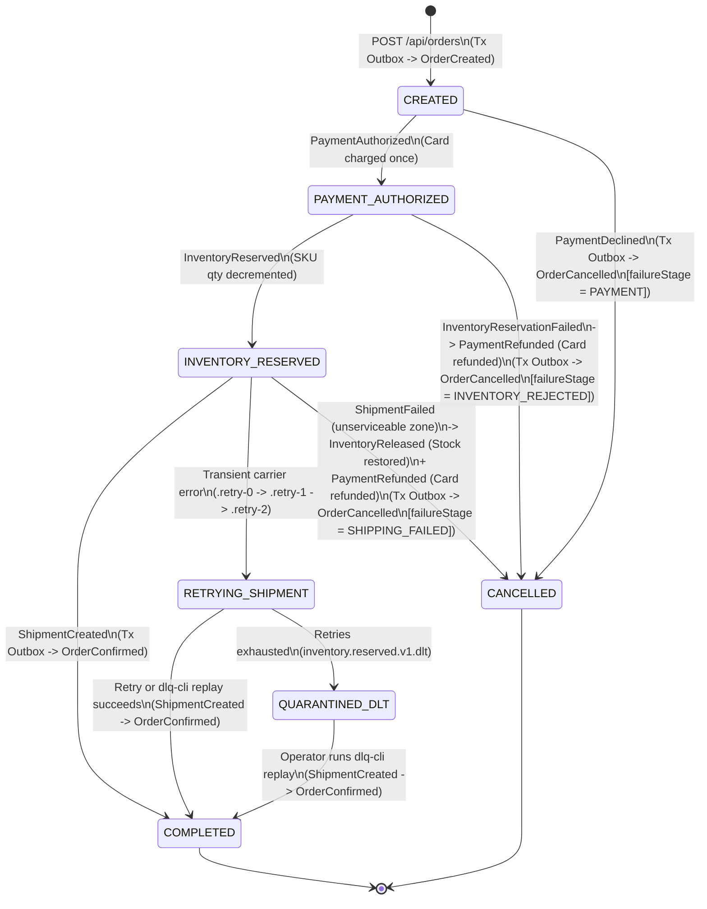

# System Design: Event-Driven Order Platform on Apache Kafka 4.4.0 (KRaft)

## 1. Requirements & Architectural Constraints

### Functional Requirements
1. Accept customer orders (`POST /api/orders`) and execute payment authorization, SKU stock reservation, carrier shipment scheduling, order confirmation, and customer notifications asynchronously.
2. Unwind partial work deterministically via compensating domain events whenever payment is declined, inventory is insufficient, or shipment scheduling fails.
3. Quarantine malformed or repeatedly failing records into a Dead-Letter Topic (`.dlt`) without stalling healthy orders on the same partition, and provide CLI tooling (`dlq-cli`) to inspect and replay quarantined records.

### Non-Functional Constraints & Guardrails
- **Zero Inter-Service HTTP:** All five microservices (`order-service`, `payment-service`, `inventory-service`, `shipping-service`, `notification-service`) communicate **exclusively** via Apache Kafka Avro events. Verified continuously by `NoInterServiceHttpArchitectureTest`.
- **Database-per-Service Isolation:** Five physically separate PostgreSQL 17.11 instances (`order-db`, `payment-db`, `inventory-db`, `shipping-db`, `notification-db`) prevent shared-table coupling.
- **Zero Acknowledged Data Loss:** Surviving the sudden loss (`SIGKILL`) of any single Kafka broker under active load with zero lost acknowledged orders.
- **No Double Customer Charges:** Surviving a hard process crash (`SIGKILL`) inside `payment-service` mid-Kafka-transaction without charging the customer's card twice.
- **Contract Governance:** `BACKWARD` Avro schema compatibility enforced both in CI (`SchemaBackwardCompatibilityValidator`) and at runtime in Apicurio Registry 3.3.4.
- **End-to-End Observability:** Single OpenTelemetry W3C `traceId` propagated across the PostgreSQL transactional outbox, every Kafka topic hop, retry/DLT headers, and into Jaeger 2.23.0.

---

## 2. Topic Design & Parameter Justifications

Broker auto-topic creation is disabled (`auto.create.topics.enable=false`). All **11 domain topics** plus their **3 non-blocking retry topics (`.retry-0..2`) and `.dlt` dead-letter topics** (**55 topics total**) are provisioned explicitly as code in `PlatformTopicsConfiguration`:

| Topic Name | Producer | Consumer Group(s) | Key | Partitions | RF | `min.insync.replicas` |
|---|---|---|---|---:|---:|---:|
| `order.created.v1` | `order-service` (Outbox) | `payment-service-group` | `orderId` | 6 | 3 | 2 |
| `payment.authorized.v1` | `payment-service` (Kafka TX) | `inventory-service-group`, `order-service-group` | `orderId` | 6 | 3 | 2 |
| `payment.declined.v1` | `payment-service` (Kafka TX) | `order-service-group` | `orderId` | 6 | 3 | 2 |
| `payment.refunded.v1` | `payment-service` (Kafka TX) | `order-service-group`, `notification-service-group` | `orderId` | 6 | 3 | 2 |
| `inventory.reserved.v1` | `inventory-service` | `shipping-service-group`, `order-service-group` | `orderId` | 6 | 3 | 2 |
| `inventory.rejected.v1` | `inventory-service` | `payment-service-group`, `order-service-group` | `orderId` | 6 | 3 | 2 |
| `inventory.released.v1` | `inventory-service` | `payment-service-group`, `order-service-group` | `orderId` | 6 | 3 | 2 |
| `shipping.scheduled.v1` | `shipping-service` | `order-service-group`, `notification-service-group` | `orderId` | 6 | 3 | 2 |
| `shipping.failed.v1` | `shipping-service` | `inventory-service-group`, `order-service-group` | `orderId` | 6 | 3 | 2 |
| `order.confirmed.v1` | `order-service` (Outbox) | `notification-service-group` | `orderId` | 6 | 3 | 2 |
| `order.cancelled.v1` | `order-service` (Outbox) | `notification-service-group` | `orderId` | 6 | 3 | 2 |
| `<domain>.retry-0` | Consumer service | `<service>-group` (non-blocking backoff tier 1) | `orderId` | 6 | 3 | 2 |
| `<domain>.retry-1` | Consumer service | `<service>-group` (non-blocking backoff tier 2) | `orderId` | 6 | 3 | 2 |
| `<domain>.retry-2` | Consumer service | `<service>-group` (non-blocking backoff tier 3) | `orderId` | 6 | 3 | 2 |
| `<domain>.dlt` | Consumer service | `dlq-cli`, DLT audit listener (30-day retention) | `orderId` | 6 | 3 | 2 |

### Justification of Each Choice
1. **Explicit Partition Count = `6`:**
   `6 = lcm(1, 2, 3, 6)`. Under KIP-848 (`group.protocol=consumer`), scaling a service between **1, 2, 3, or 6 replicas** distributes partitions evenly (`6`, `3+3`, `2+2+2`, or `1×6`) with zero idle instances and zero skew. Keeping partition count at `6` per topic (`90` partitions total across 15 topics, `270` replicas across 3 brokers) provides substantial horizontal concurrency while avoiding KRaft metadata inflation, slow leader failovers, and open file-descriptor pressure caused by over-partitioning.
2. **Replication Factor = `3`:**
   Every partition has 1 leader and 2 followers spread across all 3 brokers (`kafka-1`, `kafka-2`, `kafka-3`). Losing one broker leaves 2 live replicas, preserving high availability even if a second broker undergoes a brief network blip before disk loss occurs. Internal coordination topics (`__consumer_offsets` and `__transaction_state`) are likewise pinned to `replication.factor=3`.
3. **`min.insync.replicas = 2` (with `acks=all` & `unclean.leader.election.enable=false`):**
   With `N = 3` replicas and write quorum `W = 2` (`min.insync.replicas = 2`), no producer write is acknowledged until both the leader and at least one caught-up follower persist the record. Combined with `unclean.leader.election.enable=false`, only an in-sync replica (`ISR`) can win leader election (`R_leader in ISR`). By quorum intersection, every surviving ISR member holds 100% of acknowledged records when a broker crashes, eliminating silent data loss while still tolerating `1` broker outage (`3 - 2 = 1` fault tolerance).
4. **Keyed by `orderId`:**
   Kafka guarantees total ordering only **within a single partition**. Keying every record by `orderId` maps all lifecycle events for a specific order (`murmur2(orderId) mod 6`) to the same partition index, preserving per-order causal ordering (`PaymentAuthorized` before `PaymentRefunded`, `OrderCreated` before `OrderConfirmed`) while allowing independent orders to execute concurrently across all 6 partitions.

---

## 3. Delivery Guarantees Per Hop & Where Kafka's EOS Boundary Stops

### Hop-by-Hop Delivery Matrix

| Hop | Producer Mechanism | Broker / Wire Guarantee | Consumer Mechanism | Effective End-to-End Semantics |
|---|---|---|---|---|
| **1. Client -> `order-service` -> `order.created.v1`** | Single PostgreSQL ACID TX writes `orders` + `outbox_events`; `FOR UPDATE SKIP LOCKED` relay sends with `acks=all`, `enable.idempotence=true` | At-least-once relay if `order-service` crashes after broker ACK before `UPDATE outbox_events SET published_at` | `payment-service` checks `payment_ledger(order_id UNIQUE)` + `processed_events(event_id PK)` | **Effectively-once** (zero divergence between DB & Kafka) |
| **2. `order.created.v1` -> `payment-service` -> `payment.authorized.v1` / `payment.declined.v1`** | **Kafka Transactions (`KafkaTransactionManager`)**: atomic `sendOffsetsToTransaction` + output event commit via `__transaction_state` | **Exactly-once log-to-log** (`isolation.level=read_committed` filters uncommitted/aborted TX markers) | External `SimulatedCardGateway` deduplicates via deterministic `idempotencyKey = "charge:" + orderId`; downstream consumers enforce `processed_events(event_id)` | **Exactly-once inside Kafka** + **Idempotent external side effect** |
| **3. `payment.authorized.v1` -> `inventory-service` -> `inventory.reserved.v1` / `inventory.rejected.v1`** | Idempotent producer (`acks=all`, `enable.idempotence=true`) | Durable ISR quorum (`RF=3, minISR=2`) | Local JDBC TX atomically updates `stock_catalog`, `stock_reservations(order_id)`, and `processed_events(event_id)` before `ack.acknowledge()`; crash recovery re-emits cached reservation on replay | **Effectively-once** stock mutation + guaranteed outbound progress |
| **4. `inventory.reserved.v1` -> `shipping-service` -> `shipping.scheduled.v1` / `.retry-*` / `.dlt`** | Idempotent producer + `RetryTopicConfiguration` (`1s -> 2s -> 4s -> .dlt`) | Non-blocking topic forwarding preserves partition liveness | `shipments(order_id UNIQUE)` + `processed_events(event_id)` before manual `ack.acknowledge()` | **Effectively-once** shipment creation; poison messages isolated in `.dlt` |
| **5. Milestone & Terminal Events -> `order-service` & `notification-service`** | Outbox (`order-service`) & idempotent producers | `read_committed` | `processed_events(event_id PK)` + `customer_notifications(dedup_key UNIQUE)` before manual offset commit | **Effectively-once** saga state transitions & customer notifications |

### Exactly Where Kafka's Transactional Guarantee Stops
`payment-service` uses Kafka's native transactional `read-process-write` pipeline (`eosKafkaListenerContainerFactory` + `KafkaTransactionManager`). Within a single Kafka transaction, the broker's transaction coordinator atomically binds two things:
1. Writing the outbound `PaymentAuthorized` (or `PaymentDeclined` / `PaymentRefunded`) record(s) to their target partitions.
2. Writing the consumed `OrderCreated` consumer offset to `__consumer_offsets`.

**Where the guarantee stops:** Kafka's transaction coordinator **cannot roll back anything outside the Kafka cluster**—most importantly, an HTTP call to an external card network (Stripe, Adyen, Braintree) or an external database commit.

Consider the exact crash window exercised by `scripts/demo-kill-payment-mid-tx.sh` (`paymentMethodToken = "tok_hold_mid_tx"`):
1. `payment-service` polls `OrderCreated(orderId = X)`.
2. Inside the open Kafka transaction, it calls the card processor to authorize `$199.00`. That external card charge **commits immediately in the outside world**.
3. `payment-service` flushes the uncommitted `PaymentAuthorized` record to the broker—invisible to `inventory-service` because `isolation.level=read_committed` withholds records lacking a `COMMIT` control marker.
4. **`SIGKILL` terminates `payment-service`** before `commitTransaction()` executes.
5. On restart, the new container initializes the same deterministic `transactional.id` prefix, **fences** the dead producer epoch, aborts the dangling Kafka transaction, and **redelivers `OrderCreated(orderId = X)`** from the uncommitted offset.

Without an external idempotency key, step 5 would charge the customer's credit card a **second time**. Because `payment-service` passes deterministic `idempotencyKey = "charge:" + orderId` (and `"refund:" + orderId` on compensation) to the card gateway, the redelivered execution retrieves the original gateway authorization (`executionCount = 1, deduplicatedRetryCount = 1`), records local ledger state idempotently, and commits the Kafka transaction cleanly. **Kafka EOS solves log-to-log atomicity; deterministic idempotency keys solve the external boundary.**

---

## 4. Choreographed Saga & Failure Compensation Paths

### Saga State Diagram (`order-service` Lifecycle & Compensations)

### Every Failure & Compensation Path
1. **Card Declined (`PaymentDeclined`):**
   - `payment-service` emits `PaymentDeclined` inside its Kafka transaction; no stock was reserved and no money was captured.
   - `order-service` transitions `CREATED -> CANCELLED` (`failureStage = PAYMENT`) and writes `OrderCancelled` to `outbox_events`.
   - `notification-service` sends `ORDER_CANCELLED` to the customer.
2. **Insufficient Stock (`InventoryReservationFailed`):**
   - `payment-service` already charged the card (`PaymentAuthorized`).
   - `inventory-service` finds `available_qty < requested_qty` and emits `InventoryReservationFailed`.
   - `payment-service` consumes `InventoryReservationFailed`, invokes the card gateway with `idempotencyKey = "refund:" + orderId`, updates its ledger to `REFUNDED`, and emits `PaymentRefunded(failureStage = "INVENTORY_REJECTED")` inside a Kafka transaction.
   - `order-service` consumes `PaymentRefunded`, transitions `orders` to `CANCELLED`, and emits `OrderCancelled` via outbox.
   - `notification-service` emits both `PAYMENT_REFUNDED` and `ORDER_CANCELLED` notifications.
3. **Unrecoverable Carrier Rejection (`ShipmentFailed`):**
   - Both card authorization and SKU reservation have already succeeded.
   - `shipping-service` rejects an unserviceable destination (`FAIL-SHIP*`) and emits `ShipmentFailed`.
   - **Fan-out compensation:**
     - `inventory-service` consumes `ShipmentFailed`, restores `available_qty` atomically (`stock_reservations.status = RELEASED`), and emits `InventoryReleased`.
     - `payment-service` consumes `ShipmentFailed`, refunds the customer (`"refund:" + orderId`), and emits `PaymentRefunded(failureStage = "SHIPPING_FAILED")`.
   - `order-service` consumes `PaymentRefunded`, transitions `INVENTORY_RESERVED -> CANCELLED`, and emits `OrderCancelled`.
4. **Transient Failure or Corrupt Poison Message (`.retry-*` -> `.dlt` -> `dlq-cli`):**
   - Corrupt wire bytes bypass retries immediately into `inventory.reserved.v1.dlt` via `ErrorHandlingDeserializer` + `AvroOrRawBytesSerializer`.
   - Transient failures traverse `.retry-0` (1s), `.retry-1` (2s), and `.retry-2` (4s) without blocking healthy orders on `inventory.reserved.v1`, landing in `inventory.reserved.v1.dlt` if still failing.
   - Operators inspect headers/payloads with `dlq-cli inspect` and republish sanitized records with `dlq-cli replay`.

---

## 5. Architectural Trade-Offs

| Decision | Chosen Approach | Alternative | Why Chosen & Trade-Off Accepted |
|---|---|---|---|
| **Outbox Relay** | `FOR UPDATE SKIP LOCKED` SQL polling (150 ms) | Debezium WAL CDC + Kafka Connect | Eliminates Kafka Connect cluster & WAL slot operational risk; trades ~75–150 ms median latency and light index polling. |
| **Saga Coordination** | Pure Event Choreography | Central Saga Orchestrator | Preserves strict bounded-context decoupling; mitigated visibility cost with 5-service Jaeger W3C tracing and `order_saga_history`. |
| **DB + Kafka Atomicity** | Local JDBC `processed_events` + idempotent recovery (`inventory`, `shipping`, `notification`) and Kafka TX + idempotent gateway (`payment`) | Distributed 2PC / XA across Postgres & Kafka | Kafka does not support XA with RDBMS, and pseudo-dual-commit managers (`ChainedKafkaTransactionManager`) are deprecated because narrow crash windows still exist; explicit idempotency is strictly safer. |
| **Poison Pill Handling** | Non-blocking `.retry-0..2` + `.dlt` topics | In-place partition pause/backoff (`DefaultErrorHandler`) | Keeps healthy orders flowing at full speed; trades per-order ordering *only* if multiple concurrent events existed for a retrying order (prevented by stage-gated saga causality). |
| **Schema Compatibility** | `BACKWARD` | `FULL_TRANSITIVE` | Allows rolling consumer-first upgrades with clean optional-field additions; `FULL_TRANSITIVE` would be adopted once external third-party teams consume archival topics out-of-band. |

---

## 6. What Would Change for Production

1. **Separated KRaft Roles & Multi-AZ Rack Awareness:** Run 3 dedicated KRaft controller nodes (`process.roles=controller`) on NVMe disks separate from `3+` stateless-compute/tiered-storage broker nodes (`process.roles=broker`), with `broker.rack` mapped across 3 cloud availability zones.
2. **mTLS, SASL/OAUTHBEARER, and Principle-of-Least-Privilege ACLs:** Encrypt `BROKER`, `CONTROLLER`, and client listeners with TLS 1.3 and enforce per-service Kafka ACLs (e.g., only `payment-service` principal may write to `payment.*` or use `TransactionalId` `payment-eos-tx-*`).
3. **Durable Apicurio Storage:** Back Apicurio Registry 3.3.4 with a dedicated HA PostgreSQL database (`APICURIO_STORAGE_KIND=sql`) rather than ephemeral container memory.
4. **Outbox Table Partitioning & Retention:** Range-partition `outbox_events` and `processed_events` daily (`pg_partman`) so completed partitions are dropped in `O(1)` metadata operations instead of `VACUUM`-heavy row deletes, and wake the poller via PostgreSQL `LISTEN/NOTIFY` (or switch to Debezium if sustained ingress exceeds ~5k orders/sec).
5. **SLO Alerting & Stuck-Saga Watchdog:** Export Micrometer metrics (`kafka_consumer_fetch_manager_records_lag_max`, outbox oldest unpublished age, `.dlt` offset growth, and orders remaining non-terminal > 5 minutes) to Prometheus/Alertmanager.
6. **PII Protection / Crypto-Shredding:** Keep `customerEmail` and shipping addresses out of long-retention Kafka events (passing opaque `customerId` tokens or per-customer KMS envelope-encrypted fields) to satisfy GDPR right-to-erasure on immutable logs.
